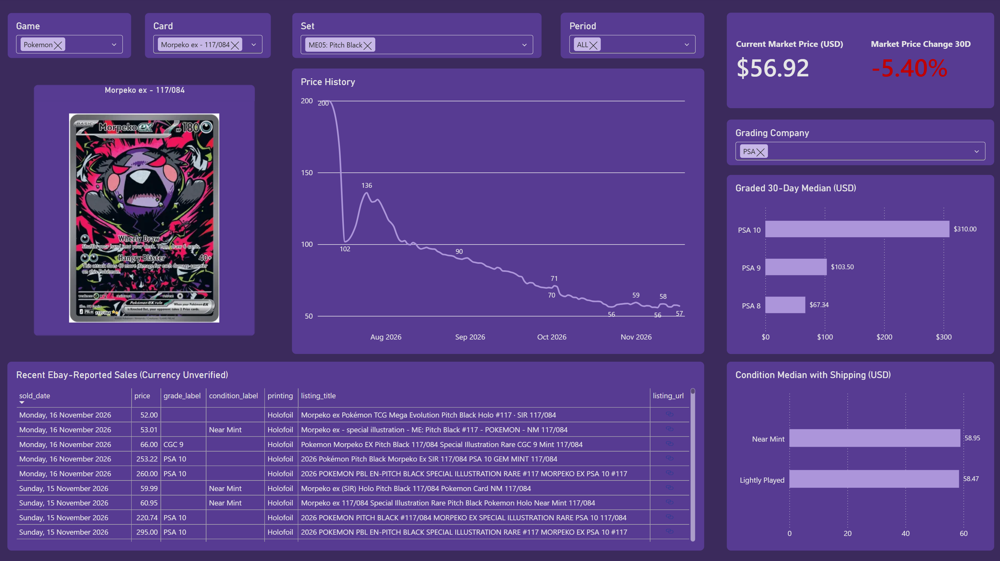

# GraildTCG — Market Data Engineering & Analytics

**Python · PostgreSQL · SQL · REST APIs · Power BI**

GraildTCG is an ongoing project with a long-term goal of building a **web-based trading card game (TCG) market intelligence platform**. The envisioned application will help collectors, sellers, and other market participants explore pricing data, historical trends, and product comparisons.

This repository documents **Phase 1: the market-data engineering and analytics foundation**. A local Python pipeline ingests catalog and pricing observations from TCGAPI.dev, validates and stores them in PostgreSQL, and exposes curated SQL views to an interactive Power BI dashboard. This phase emphasizes **reproducible ingestion, data integrity, provenance, and explicit handling of incomplete provider data**.

> **Project status:** Phase 1 ingestion, database modeling, and Power BI reporting are implemented locally. The web application is **planned, not yet built**. Automated scheduling, cloud deployment, and sealed-product ingestion are also future work. Data is provider-reported and should not be interpreted as verified financial-market or transaction data.

## Project vision and scope

The Power BI dashboard is an **analytical prototype**, used to explore the collected data and validate the pricing and reporting model before building a user-facing application.

| Stage | Scope | Status |
| --- | --- | --- |
| **Phase 1 — Data engineering & analytics** | API ingestion, normalized PostgreSQL storage, validation, historical prices, reporting views, and Power BI exploration | **Implemented locally** |
| **Future — Market intelligence web app** | Web-based card and product discovery, interactive pricing trends, comparisons, and market insights | **Planned** |

Future application capabilities are product goals, **not current repository features**. The existing pipeline provides a foundation that can be extended with a backend API and web frontend once data coverage, operations, and architecture are validated.

## Dashboard preview



The dashboard provides Game / Set / Card selection, current market price, 30-day historical price change, selectable price-history periods, condition-based pricing, graded-price comparisons, and recent provider-reported eBay sales. The sale-observation source does **not** supply verified currency; the dashboard labels that limitation rather than assuming USD.

> Screenshot is a sample of the local report. The Power BI `.pbix` and private local connection settings are intentionally not committed.

## Architecture

```text
                 TCGAPI.dev REST APIs
                (catalog + market feeds)
                          |
                          v
               Python extraction layer
            (validation, quota/retry checks)
                          |
                  +-------+-------+
                  |               |
                  v               v
         Local raw snapshots    ETL normalization
         + run manifests       + record hashing
          (Git-ignored)              |
                                     v
                            PostgreSQL tables
                          (constraints + upserts)
                                     |
                                     v
                       Read-only reporting views
                          (dim_cards + 5 facts)
                                     |
                                     v
                          Power BI (Import mode)
```

Raw API responses and run manifests remain available locally for audit and offline replay, but are excluded from the public repository.

## Engineering highlights

| Area | Implementation |
| --- | --- |
| **Ingestion** | Python clients and task-specific scripts for catalogs, history, current prices, condition prices, graded summaries, and reported sales |
| **Data modeling** | Normalized `sets → cards → price_history` entities; independent current/condition/graded/sale data structures |
| **Integrity** | PostgreSQL keys, constraints, canonical uniqueness, numeric precision, validation and explicit `NULL` handling |
| **Reliability** | Replay-safe upserts, SHA-256 source-record hashes, timestamp-aware snapshot updates, bounded retries and quota controls |
| **Traceability** | Timestamped source responses and manifests; distinction between missing provider coverage, empty values and request failures |
| **Analytics** | Six read-only reporting views; one-to-many, single-direction Power BI relationships; market and historical price measures |
| **Access control** | Restricted application login and a separate least-privilege Power BI read-only role |

### Data coverage

The initial loaded catalog covers **489 cards** across four available set catalogs. The Phase 1 dataset includes **more than 117,000 historical price observations**. Provider availability differs by set, card, feed, and region; missing coverage is reported rather than silently filled.

The initial target scope includes Pokémon English and Japanese sets and One Piece English. Some requested regional catalogs (including Japanese OP-17) were not independently available through the provider during discovery; see [set coverage findings](docs/TASK4_SET_COVERAGE.md).

### Important data semantics

- **Current snapshots vs. history:** Current-price data is timestamp-guarded; older provider observations cannot overwrite newer data. History uses a canonical card/provider/printing/currency/date identity.
- **Zero vs. missing:** Provider zero values and SQL `NULL` are preserved distinctly. Report measures can exclude zero-valued prices where they would distort a visualization.
- **Graded prices:** These are aggregated, provider-reported sold-price summaries; missing 30-day medians are not backfilled from unrelated fields.
- **Reported eBay sales:** Individual records are observations, *not* globally unique verified transactions. Replay identity is snapshot-specific, and different snapshots must not be summed as separate real-world sales.
- **Currency:** Verified pricing feeds are mapped according to endpoint metadata; individual eBay sale observations retain unknown currency when the source does not specify it.

## Repository structure

```text
config/       Ingestion configurations and example set allowlists
src/gmad/     Python extraction, validation, and loading modules
scripts/      Database bootstrap, sync commands, role configuration
sql/          Forward migrations, integrity tests, verification, reporting views
docs/         Implementation evidence and technical reports
docs/learning/  Guided engineering walkthrough and exercises
docs/images/ Dashboard preview
requirements.txt
.env.example  Environment variable template (no real credentials)
```

## Run locally (Windows / PowerShell)

**Prerequisites:** Python virtual environment, local PostgreSQL instance, and your own TCGAPI.dev API credentials. The pipeline runs locally; some extraction operations consume provider API credits. See the [environment and architecture walkthroughs](docs/learning/README.md) for context.

1. Create the local environment file and install dependencies using your preferred Python environment:

   ```powershell
   Copy-Item .env.example .env
   # Fill .env with your own local credentials; do not commit it.
   python -m venv .venv
   .\.venv\Scripts\python.exe -m pip install -r requirements.txt
   $env:PYTHONPATH = (Resolve-Path .\src)
   ```

2. Test the database connection, then bootstrap the dedicated database/application role as described in the project guide:

   ```powershell
   .\.venv\Scripts\python.exe -m gmad.smoke_test
   .\.venv\Scripts\python.exe .\scripts\bootstrap_database.py
   ```

   **Bootstrap is a one-time operation.** It refuses to change existing database or role objects with the same names. Review the current `.env.example` and [original setup guidance](docs/learning/03_ENVIRONMENT_SETUP.md) before running it.

3. Apply forward-only SQL migrations in order (`sql/001_...` through `sql/010_...`), using the migration instructions documented in [database and SQL](docs/learning/04_DATABASE_AND_SQL.md) and the individual task reports. Do **not** rerun already-applied schema migrations indiscriminately.

4. Run only the ingestion workflows you intend to test; for example, once the core schema and provider IDs are configured:

   ```powershell
   .\.venv\Scripts\python.exe .\scripts\sync_target_catalogs.py
   .\.venv\Scripts\python.exe .\scripts\sync_price_history.py
   ```

   Run the verification SQL with the SQL runner:

   ```powershell
   .\.venv\Scripts\python.exe .\scripts\run_sql_file.py .\sql\verify_price_history_load.sql --read-only
   ```

   For graded summaries and reported sales, prefer offline `--replay-run` when validating ingestion. `--fetch` may consume API credits; review the budget/quota checks in the relevant task reports first.

5. Configure the Power BI reporting role after the reporting migration:

   ```powershell
   .\.venv\Scripts\python.exe .\scripts\configure_power_bi_role.py
   .\.venv\Scripts\python.exe .\scripts\configure_power_bi_role.py --verify-only
   ```

   Connect Power BI Desktop in **Import** mode to the six read-only `reporting` views, following [Power BI model notes](docs/TASK10_POWER_BI_MODEL.md). The `.pbix` file is not distributed in this repository.

**Note:** The steps above are an orientation, not a one-command installer. Follow the linked migration/task documentation for the exact starting database state, prerequisites and API-credit implications.

## Technical documentation

- [Set coverage and provider limitations](docs/TASK4_SET_COVERAGE.md)
- [Price-history pipeline](docs/TASK5_PRICE_HISTORY_REPORT.md)
- [Current-price snapshots](docs/TASK6_CURRENT_PRICE_REPORT.md)
- [Condition-level prices](docs/TASK7_CONDITION_PRICE_REPORT.md)
- [Graded price summaries](docs/TASK8_GRADED_PRICE_REPORT.md)
- [Reported sale ingestion and caveats](docs/TASK9_REPORTED_SALES_REPORT.md)
- [Power BI reporting model](docs/TASK10_POWER_BI_MODEL.md)
- [End-to-end engineering learning guide](docs/learning/README.md)
- [Planned post-MVP improvements](POST_MVP_IMPROVEMENTS.md)

## Next improvements

**Toward the market intelligence web app**

- Design a backend API to expose curated market data to a future frontend.
- Prototype a web experience for card discovery, price-history exploration, and product comparisons.
- Validate sealed-product coverage and data modeling before adding product-category comparisons.

**Strengthening the data platform**

- Schedule and monitor incremental ingestion runs, with alerting and failure recovery.
- Introduce automated CI checks and more repeatable environment setup.
- Evaluate cloud deployment and incremental refresh.

## Security and attribution

API keys and local database passwords belong in ignored `.env` files and must never be committed. Raw source payloads and database exports are likewise kept out of Git. TCGAPI.dev and trading-card artwork belong to their respective owners; this repository is an independent educational/portfolio implementation and an early stage of a proposed product, not an operating marketplace or pricing authority.
