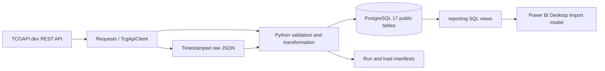

# Chapter 2 — GraildTCG System Architecture

## End-to-end flow

`src/gmad/tcgapi_client.py::TcgApiClient` is the HTTP boundary. Pipeline modules
select configured records from PostgreSQL, request provider data, save exact
response text, parse with `Decimal`, validate shapes and values, calculate
hashes, then load through `src/gmad/db.py::connect`.

## Component responsibilities

| Component | Responsibility | It deliberately does not do |
| --- | --- | --- |
| TCGAPI.dev | Provider catalogs and market data | Guarantee all target languages or sale identity |
| Python modules | Fetch, validate, transform, hash, and load | Serve dashboard queries |
| Raw run folders | Preserve source evidence and resumable state | Act as the analytical database |
| PostgreSQL `public` | Enforce keys, types, relationships, and canonical state | Infer missing provider values |
| PostgreSQL `reporting` | Present documented fact/dimension grains | Modify operational data |
| Power BI | Import and relate reporting views | Trigger provider calls per user |

## Why this stack

- **Python** is readable and has strong libraries for HTTP, JSON, decimals, and
  database access. Its limitation is that discipline is required: dynamic JSON
  still needs explicit validation.
- **PostgreSQL 17** provides ACID transactions, `NUMERIC`, constraints,
  identities, indexes, views, and efficient `COPY`. A local server is excellent
  for learning, though production operation would need backups and monitoring.
- **Psycopg 3** offers Pythonic transactions, parameterized SQL, and streaming
  `COPY`. It keeps the project close to SQL instead of hiding behavior behind an
  ORM.
- **Requests** makes HTTP behavior visible. It is synchronous, so concurrency is
  bounded with thread pools only where useful.
- **python-dotenv** loads local secrets from ignored files. It is convenient for
  development, not a production secrets manager.
- **JSON** preserves the provider response naturally. JSON is flexible but does
  not enforce relational constraints.
- **Git** tracks code and documentation; raw secrets and local environments are
  ignored.
- **Power BI** quickly validates a star schema. Service deployment and scheduled
  refresh are intentionally deferred.

## Security boundaries

The application uses `graildtcg_app`, created by
`scripts/bootstrap_database.py`, rather than the PostgreSQL superuser. Power BI
uses `graildtcg_powerbi`, configured by
`scripts/configure_power_bi_role.py`, with SELECT access only to six views.
`.env` and `.env.powerbi` are ignored.

## Architectural tradeoff

Raw files live under OneDrive in this local MVP. That gives inspectable evidence
and easy recovery, but OneDrive briefly locked atomic manifest renames during
Task 9. `reported_sale_ingest.py::_write_json_atomic` now retries short locks.
Durable object storage is a future improvement, not an implemented component.

## Comprehension check

Trace a condition price from HTTP response to Power BI. Name the raw folder,
Python module, SQL table, reporting view, and relationship key it crosses.

