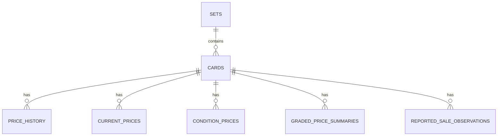

# Chapter 4 — Database Design and SQL

## Start with grain, then keys

The **grain** defines one row. Keys and constraints should encode that sentence.
GraildTCG uses internal identity columns (`set_id`, `card_id`) for relationships
and keeps provider IDs (`tcgapi_set_id`, `tcgapi_card_id`) as source identities.
This prevents downstream tables from depending on every provider's key format.



All foreign keys use `ON UPDATE RESTRICT ON DELETE RESTRICT`; a set or card
cannot be silently removed while facts still refer to it.

## Final table reference

### `sets`

**Grain:** one canonical provider/source release. Migration:
`sql/003_add_sets_table.sql`.

- Identity: `set_id` primary key; `(source_name, source_set_key)` unique;
  `(source_name, tcgapi_set_id)` unique when the provider ID exists.
- Metadata: provider ID, game ID/name, set name/code, language, region, release
  date.
- Provenance: `source_name`, `source_observed_at`, `loaded_at`.
- Checks: positive IDs, nonblank text, and language syntax such as `en`, `ja`,
  or `zh-Hans`.

`source_set_key` remains required even when a provider ID is unavailable. This
is the stable source-namespace identity; it is not an invitation to invent an
API identifier.

### `cards`

**Grain:** one TCGAPI card ID. Created in `001`, revised in `002`–`004`.

- `card_id` is the internal primary key; `tcgapi_card_id` is unique.
- `set_id` references `sets`; `tcgplayer_id` is optional.
- Name, optional collector number, rarity, optional normalized `variant_name`,
  image URL, and provenance are preserved.
- `card_number` became nullable in `004_allow_missing_card_number.sql` after
  valid DON!! catalog records were observed without a number.

### `price_history`

**Grain:** one daily observation per card, source, printing, currency, and date.

The unique constraint is:

```sql
UNIQUE (card_id, source_name, printing, currency_code, observation_date)
```

Columns include three nullable prices, nullable sales volume, raw-file/row
provenance, a 64-character SHA-256 hash, and `loaded_at`. Indexes support
card/date and card/printing/date access. Migration `005` changed prices from
`NUMERIC(12,2)` to `NUMERIC(14,4)` after a real `0.1324` value was discovered.

### `current_prices`

**Grain:** one latest snapshot per card, source, currency, and printing.
Migration: `006_create_current_prices.sql`.

Prices are `NUMERIC(30,16)`. `market_price_as_of` describes the market value's
date, `provider_observed_at` orders snapshots, and `loaded_at` records database
ingestion. `no_market_price_since` preserves provider staleness. A stored
generated column flags—not reinterprets—a zero market price:

```sql
market_price_is_zero BOOLEAN GENERATED ALWAYS AS (
    COALESCE(market_price = 0, FALSE)
) STORED
```

### `condition_prices`

**Grain:** one latest snapshot per card, source, currency, printing, condition,
and listing language. Migration: `007_create_condition_prices.sql`.

It stores low, lowest-with-shipping, nullable median-with-shipping,
`sample_count`, provider time, provenance, and hash. Condition is validated as
nonblank text—not an enum—because live data included `Unopened`. Listing
language is distinct from the set's language.

### `graded_price_summaries`

**Grain:** one canonical aggregate per card, source, currency, printing, and raw
grade label. Migration: `008_create_graded_price_summaries.sql`.

`median_30d` is nullable and separate from `last_sale_price`/`last_sold_date`.
`graded_days` and `ungraded_days` are separate 0–30 windows.
`is_reported_in_latest_snapshot` distinguishes current from retained last-known
grades; `coverage_checked_at` records when presence/absence was evaluated.

### `reported_sale_observations`

**Grain:** one provider-returned array position inside one immutable extraction
snapshot, card, and printing. Migration:
`009_create_reported_sale_observations.sql`.

```sql
UNIQUE (source_snapshot_key, card_id, printing, source_row_number)
```

The row preserves sold date, price, best-offer flag, nullable list price, raw
grade/condition, title, URL, parent provider date, capture time, path, and hash.
Currency is nullable because the response did not provide it. This key makes a
saved snapshot replayable; it does **not** prove transaction uniqueness across
snapshots.

## Constraints, indexes, and transaction management

All price checks allow `NULL` but reject negative numbers. Currency checks
require uppercase three-letter codes when a currency is known. Hash checks
require lowercase 64-character hexadecimal SHA-256. Positive-ID and nonblank
checks catch invalid records near the data boundary.

Indexes follow common filters: card IDs, dates, provider observation times,
snapshot key, and current/last-known status. Unique constraints double as the
conflict targets for upserts.

Psycopg connection context managers commit on success and roll back on
exception. Large loaders create a transaction-local temp table, stream rows via
`COPY`, and issue one set-based insert/upsert. A partially failed load does not
leave half the batch committed.

## Upsert semantics

Current and condition tables guard the conflict update:

```sql
ON CONFLICT ON CONSTRAINT uq_current_prices_canonical_snapshot
DO UPDATE SET ...
WHERE EXCLUDED.provider_observed_at > current_prices.provider_observed_at
   OR (
       EXCLUDED.provider_observed_at = current_prices.provider_observed_at
       AND current_prices.source_record_hash IS DISTINCT FROM
           EXCLUDED.source_record_hash
   );
```

Line by line: the unique constraint finds the canonical row; a newer provider
time may replace it; equal-time changed content is a provider revision; an older
row cannot overwrite newer state. Missing incoming keys are retained.

History differs: each date is already part of the key, so new dates insert and a
changed hash revises that exact date. Reported sales differ again: immutable
same-key/different-hash data raises `DataIntegrityError` before writing.

## Why migrations evolved

The schema was not “wrong” because it changed. Evidence improved the model:

1. `001` established cards and history.
2. `002` added provider/currency semantics and canonical uniqueness.
3. `003` normalized repeated set metadata.
4. `004` accepted real missing collector numbers.
5. `005` preserved real four-decimal history.
6. `006`–`009` added distinct fact types only after response discovery.
7. `010` added a read-only reporting layer.

Early migrations explicitly required empty tables when a safe automatic backfill
could not be guaranteed. That is safer than guessing production values.

## SQL teaching lab: keys and relationships

### Primary keys

From `sql/006_create_current_prices.sql`:

```sql
current_price_id BIGINT GENERATED ALWAYS AS IDENTITY,
CONSTRAINT pk_current_prices PRIMARY KEY (current_price_id)
```

`BIGINT` gives a large integer range. PostgreSQL generates the identity value;
the application does not need to coordinate IDs. The primary key means the
column is unique and non-null and provides a stable target for references or
diagnostics. It does **not** express the business grain—that is the job of the
canonical unique constraint below.

### Foreign keys

```sql
CONSTRAINT fk_current_prices_card
    FOREIGN KEY (card_id)
    REFERENCES cards (card_id)
    ON UPDATE RESTRICT
    ON DELETE RESTRICT
```

Line by line:

1. Name the constraint so errors are diagnosable.
2. Declare `current_prices.card_id` as the child value.
3. Require it to exist in the parent `cards.card_id` primary key.
4. Refuse parent-key changes while facts refer to it.
5. Refuse card deletion while facts refer to it.

**Initial state:** `cards` contains `card_id=182`; it has no current-price row.
**Incoming data:** a current price references `card_id=999999`, which does not
exist. **Operation:** `INSERT`. **Result:** PostgreSQL raises
`foreign_key_violation`; the transaction can roll back without an orphan.

### Composite uniqueness

```sql
CONSTRAINT uq_current_prices_canonical_snapshot
    UNIQUE (card_id, source_name, currency_code, printing)
```

The four values together identify one current snapshot. Card 182 may have USD
and another currency, or Normal and Holofoil printings, but it may not have two
rows for the same source/currency/printing combination.

`condition_prices` needs two more dimensions:

```sql
UNIQUE (
    card_id, source_name, currency_code, printing,
    condition_name, listing_language
)
```

Omitting condition or listing language would make legitimately different rows
collide.

## SQL teaching lab: checks, numeric precision, NULL, and zero

### CHECK constraints

```sql
CONSTRAINT chk_current_prices_market_nonnegative
    CHECK (market_price IS NULL OR market_price >= 0)
```

The expression permits unknown values and nonnegative reported values. A
negative value makes the expression false and is rejected. In PostgreSQL a
`CHECK` also passes when its expression is unknown, which is why `NOT NULL` is
separate when absence must be forbidden.

```sql
CONSTRAINT chk_current_prices_no_market_price_timing
    CHECK (
        no_market_price_since IS NULL
        OR no_market_price_since <= provider_observed_at
    )
```

This preserves the provider's staleness marker while preventing an impossible
sequence in which the market-price absence begins after the snapshot time.

### NUMERIC rather than floating point

Historical prices use `NUMERIC(14,4)` after a real four-decimal value was
observed. Current prices use `NUMERIC(30,16)`:

```sql
market_price NUMERIC(30, 16)
```

Precision 30 is the total digit count; scale 16 is the maximum digits after the
decimal point. That leaves up to 14 integer digits. `NUMERIC` stores decimal
values exactly within the declared precision, unlike binary floating point.
Python validates this same boundary before `COPY`.

### NULL is not zero

Suppose two provider rows contain:

| Card | JSON value | Python | PostgreSQL | Meaning |
| --- | --- | --- | --- | --- |
| A | `null` | `None` | `NULL` | not supplied/unknown |
| B | `0` | `Decimal("0")` | `0` | provider reported zero |

These predicates answer different questions:

```sql
WHERE market_price IS NULL  -- unknown or absent value
WHERE market_price = 0      -- reported numeric zero
```

`market_price_is_zero` flags the second case for future validation. It does not
convert a zero to `NULL` and does not claim that the card is genuinely free.

## SQL teaching lab: INSERT, UPDATE, and upsert

### Plain INSERT

```sql
INSERT INTO current_prices (
    card_id, printing, market_price, total_listings,
    provider_observed_at, source_name, currency_code,
    source_file, source_row_number, source_record_hash
) VALUES (
    182, 'Normal', 0.13, 135,
    '2026-11-17T01:26:24.933Z', 'tcgapi.dev', 'USD',
    'data/raw/example.json', 2, repeat('a', 64)
);
```

This teaching statement omits nullable columns and relies on defaults where
available. In the real loader, values are parameterized and staged; never build
SQL by concatenating API text.

### Plain UPDATE

```sql
UPDATE current_prices
SET market_price = 0.14,
    loaded_at = CURRENT_TIMESTAMP
WHERE card_id = 182
  AND source_name = 'tcgapi.dev'
  AND currency_code = 'USD'
  AND printing = 'Normal';
```

`SET` describes changes; `WHERE` selects rows. Without the `WHERE`, every row
would be updated. The production pipeline does not use this unguarded pattern
for snapshots because it also needs timestamp and hash rules.

### `ON CONFLICT DO UPDATE`: a four-state example

Assume this initial canonical row:

| key | provider time | price | hash |
| --- | --- | ---: | --- |
| `182/tcgapi.dev/USD/Normal` | `2026-11-17 01:26Z` | 0.13 | `aaa...` |

The production conflict clause can receive four kinds of incoming data:

| Incoming state | SQL result | Final state |
| --- | --- | --- |
| no existing key | INSERT | incoming row |
| newer time, 0.15, `bbb...` | UPDATE | newer/0.15/`bbb...` |
| same time, same hash | no-op | initial row unchanged |
| older time, 0.99, `ccc...` | no-op | initial row unchanged |

```sql
ON CONFLICT ON CONSTRAINT uq_current_prices_canonical_snapshot
DO UPDATE SET
    market_price = EXCLUDED.market_price,
    provider_observed_at = EXCLUDED.provider_observed_at,
    source_record_hash = EXCLUDED.source_record_hash,
    loaded_at = CURRENT_TIMESTAMP
WHERE
    EXCLUDED.provider_observed_at > current_prices.provider_observed_at
    OR (
        EXCLUDED.provider_observed_at = current_prices.provider_observed_at
        AND current_prices.source_record_hash IS DISTINCT FROM
            EXCLUDED.source_record_hash
    );
```

Line by line:

1. Match conflicts using the complete canonical grain.
2. Enter the update branch only when that key already exists.
3. `EXCLUDED` names the incoming candidate.
4. Copy its fields only if the final `WHERE` is true.
5. Accept a strictly newer provider observation.
6. Also accept changed content at the same provider time as a revision.
7. `IS DISTINCT FROM` compares safely even if a compared value can be null.
8. An older or exact-repeat candidate affects zero canonical rows.

## SQL teaching lab: transactions and rollback

```sql
BEGIN;

INSERT INTO cards (...);
INSERT INTO current_prices (...);

-- Inspect before deciding whether this teaching run is valid.
SELECT count(*) FROM current_prices;

ROLLBACK;
```

`BEGIN` starts one unit of work. If a later statement fails, PostgreSQL marks
the transaction failed and nothing should be committed. `ROLLBACK` discards all
changes. The repository's `test_*.sql` files deliberately end this way, so
constraint tests cannot contaminate operational data. Psycopg connection
context managers provide the equivalent commit-on-success/rollback-on-error
behavior for loaders.

## SQL teaching lab: temporary tables and COPY

The production loader does not issue hundreds of independent inserts. It first
creates a temporary table with canonical types:

```sql
CREATE TEMP TABLE incoming_current_prices ON COMMIT DROP AS
SELECT card_id, printing, market_price, provider_observed_at,
       source_name, currency_code, source_file,
       source_row_number, source_record_hash
FROM current_prices
WITH NO DATA;
```

- `TEMP` makes the table session-local.
- `ON COMMIT DROP` removes it at transaction completion.
- `AS SELECT ... FROM current_prices` copies selected column definitions.
- `WITH NO DATA` copies no production rows.

Psycopg streams validated rows with `COPY ... FROM STDIN`. One
`INSERT ... SELECT FROM incoming_current_prices ON CONFLICT ...` then applies
set-based rules. If row 400 is invalid, the same transaction rolls back the
stage and canonical statement; rows 1–399 do not remain half-loaded.

## SQL teaching lab: indexes and query performance

Migration 006 creates:

```sql
CREATE INDEX idx_current_prices_card_id
    ON current_prices (card_id);

CREATE INDEX idx_current_prices_provider_observed_at
    ON current_prices (provider_observed_at);
```

The first supports joins and filters from the card dimension. The second helps
time-based freshness investigations. The composite unique constraint also
creates an index usable for canonical-key lookup and conflict detection.

An index is not free: inserts/updates must maintain it and it consumes disk.
Add indexes for observed access patterns, then compare plans:

```sql
EXPLAIN (ANALYZE, BUFFERS)
SELECT *
FROM current_prices
WHERE card_id = 182;
```

On a tiny table PostgreSQL may correctly choose a sequential scan. Performance
claims should be based on representative volume and query plans, not on the
mere presence of an index.

## Practice exercises

1. Explain why `(card_id, printing)` is unsafe for `condition_prices`. List
   every omitted key dimension.
2. Predict whether each value passes the market-price check: `NULL`, `0`,
   `-0.01`, and `12.3456`.
3. Starting with the four-state table above, process an equal-time incoming row
   with price 0.14 and a different hash. What changes and why?
4. Write a query that reports duplicate canonical history keys without using
   `price_history_id`.
5. Why does the loader use both a temporary table and a transaction rather than
   treating either one as sufficient?

Solutions are in [Exercise answer key](16_EXERCISE_ANSWER_KEY.md#chapter-4--database-design-and-sql).

