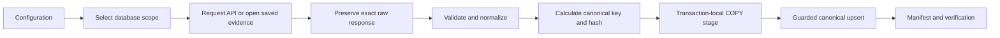

# Chapter 6 — Python Codebase Walkthrough

This chapter teaches how the implemented Python components cooperate. Every
signature below was checked against `src/gmad/`; abbreviated excerpts use `...`
only where unrelated statements were removed.

## The recurring boundary pattern

Each pipeline crosses the same boundaries:



The important design idea is separation. A request function should not quietly
write canonical tables, and a database loader should not need the network. This
makes failures easier to locate and paid responses safe to replay offline.

## 1. Configuration loading

**Source and signature**

```python
# src/gmad/config.py
@classmethod
def from_environment(cls) -> "DatabaseSettings":
```

This class method takes no ordinary arguments. `cls` is the dataclass class. It
returns an immutable `DatabaseSettings(host, port, database, user, password)`.
Its dependencies are `os.getenv`, `python-dotenv`, and the module-level call
that loads the project `.env`.

```python
values = {
    "host": os.getenv("PGHOST", "localhost"),
    "port": os.getenv("PGPORT", "5432"),
    "database": os.getenv("PGDATABASE"),
    "user": os.getenv("PGUSER"),
    "password": os.getenv("PGPASSWORD"),
}

missing = [
    name for name in ("database", "user", "password")
    if not values[name] or values[name] == "replace_me"
]
```

The first block converts process environment variables into a named mapping.
Host and port have local defaults; database, user, and password do not. The
second block rejects both absent values and the documented placeholder. The
port is then converted with `int`; an invalid value is re-raised as a clearer
`ValueError("PGPORT must be an integer.")`.

**Data change:** untyped strings in the environment become a typed, frozen
settings object. **Failure effect:** no PostgreSQL connection is attempted.
Callers such as `db.connect`, database bootstrap, and Power BI role setup stop
at a configuration error. The function never logs the password.

Pipeline JSON configuration uses the same philosophy. For example, the exact
signature below reads a path and returns a frozen policy object:

```python
# src/gmad/current_price_ingest.py
def load_current_price_config(path: Path) -> CurrentPriceConfig:
```

It requires a three-letter uppercase currency, a positive page size no greater
than 200, a positive expected card count, and a nonempty set-key list. This
keeps operational policy in JSON while secrets remain in `.env`.

## 2. API request handling and exact JSON

**Source and signature**

```python
# src/gmad/tcgapi_client.py
def get_json_with_raw(
    self, endpoint: str, params: dict[str, Any] | None = None
) -> tuple[dict[str, Any], str]:
```

`endpoint` is a path relative to `https://api.tcgapi.dev/v1`; `params` is an
optional query mapping. The return value contains both the parsed object and
the exact response text. It depends on the configured Requests `Session`, the
private `_get` method, `json`, and `Decimal`.

```python
response = self._get(endpoint, params)
raw_text = response.text
payload = json.loads(raw_text, parse_float=Decimal)
if not isinstance(payload, dict):
    raise ValueError(f"Expected an object response from {endpoint}.")
return payload, raw_text
```

Line by line:

1. `_get` joins the base URL and endpoint, supplies the configured timeout,
   sends headers, and calls `raise_for_status()`.
2. `response.text` is retained before transformation.
3. `parse_float=Decimal` prevents immediate binary-float approximation.
4. The top-level API contract is enforced as a JSON object.
5. Parsed working data and immutable evidence are returned together.

HTTP errors, timeouts, connection errors, invalid JSON, and wrong top-level
shape propagate. In ordinary pipelines this aborts extraction before the
database load. Task 9 deliberately uses the session directly because it must
classify retryable HTTP statuses and account for every possibly charged
attempt.

Endpoint helpers add contract checks. For example,
`get_bulk_history(card_ids, history_range="all")` rejects empty batches and
batches above 50 before sending a request. That local validation prevents an
avoidable failed or chargeable call.

## 3. JSON validation and typed normalization

**Representative source and signature**

```python
# src/gmad/current_price_ingest.py
def _optional_decimal(value: Any, field: str) -> Decimal | None:
```

The function accepts a provider value and a field name for diagnostics. It
returns `None` for JSON `null` or a nonnegative finite `Decimal` that fits
`NUMERIC(30,16)`.

```python
if value is None:
    return None
if isinstance(value, bool):
    raise ValueError(f"{field} must be numeric or null.")
try:
    number = value if isinstance(value, Decimal) else Decimal(str(value))
except (InvalidOperation, ValueError) as error:
    raise ValueError(f"{field} must be numeric or null.") from error
if not number.is_finite() or number < 0:
    raise ValueError(f"{field} must be finite and nonnegative.")
```

Booleans are rejected explicitly because Python treats `bool` as a subclass of
`int`. Converting through `str` avoids importing a binary-float approximation
when a caller supplies an integer or string. The remaining code measures scale
and integer digits so PostgreSQL will not round or reject the value later.

`fetch_current_prices(client, config, catalogs, run_directory)` combines these
small validators. For every response row it validates card identity,
`product_type`, printing, prices, listing count, ISO date, timezone-aware
provider timestamp, and staleness ordering. It then creates an immutable
`CurrentPriceRow` dataclass. A malformed row raises `ValueError`; because the
canonical database loader has not started, no partial current-price batch is
committed.

## 4. Raw-response preservation

**Source and signature**

```python
# src/gmad/current_price_ingest.py
def _write_raw(path: Path, raw_text: str) -> None:
```

```python
path.parent.mkdir(parents=True, exist_ok=True)
with path.open("w", encoding="utf-8", newline="") as file:
    file.write(raw_text)
```

The caller provides a timestamped run path such as
`data/raw/tcgapi_current/<run_id>/<set_id>/cards_page_001.json`. The function
creates only the needed parent folders and writes the exact response text. It
returns `None`. Failure raises the underlying filesystem exception, so the
pipeline cannot claim completion without its evidence file.

Task 9 adds a second preservation primitive:

```python
# src/gmad/reported_sale_ingest.py
def _write_json_atomic(path: Path, payload: Any) -> None:
```

It writes a `.tmp` file and atomically replaces the manifest, retrying up to 50
short Windows/OneDrive locks. Raw card bodies are saved before manifest success
is recorded. Therefore a resume can recover an HTTP 200 body even if the
manifest rename was interrupted.

## 5. Stable record hashing

**Source and signature**

```python
# src/gmad/current_price_ingest.py
def _record_hash(row: CurrentPriceRow) -> str:
```

The function takes one normalized dataclass and returns a lowercase 64-character
SHA-256 hex digest. It has no I/O.

```python
normalized = {
    "currency_code": row.currency_code,
    "market_price": _decimal_for_hash(row.market_price),
    "printing": row.printing,
    "provider_observed_at": row.provider_observed_at.isoformat(),
    "source_name": row.source_name,
    "tcgapi_card_id": row.tcgapi_card_id,
    # other price and listing fields are also included
}
encoded = json.dumps(
    normalized, sort_keys=True, separators=(",", ":"), ensure_ascii=False
).encode("utf-8")
return sha256(encoded).hexdigest()
```

`Decimal` values become fixed-point strings, dates/timestamps become ISO text,
keys are sorted, and insignificant JSON whitespace is removed. Thus formatting
differences in the API body do not change the hash, but a meaningful normalized
field does.

The canonical key and hash answer different questions:

- `(card_id, source_name, currency_code, printing)` asks which current row the
  observation competes with.
- `source_record_hash` asks whether its normalized content differs.

If hashing fails, the row is not added to the validated collection and loading
does not begin. For reported sales, `_observation_hash(...)` additionally
includes the immutable snapshot replay key and the full normalized sale object.
A same-key/different-hash replay is treated as evidence corruption and raises
`DataIntegrityError`.

## 6. PostgreSQL connection and transaction boundary

**Source and signature**

```python
# src/gmad/db.py
def connect(settings: DatabaseSettings | None = None) -> Connection:
```

An optional typed settings object is accepted; otherwise environment settings
are loaded. A Psycopg `Connection` is returned with a five-second connection
timeout. Connection/authentication errors propagate.

Loaders use it like this:

```python
with connect() as connection:
    with connection.cursor() as cursor:
        # compare, stage, and upsert
```

Psycopg's connection context commits when the block exits normally and rolls
back when an exception leaves the block. This one block therefore contains the
existing-row comparison, temporary stage, canonical upsert, and final count.
If `COPY`, a constraint, or verification query fails, none of that transaction
is committed.

## 7. Bulk staging with `COPY`

**Containing function and exact signature**

```python
# src/gmad/current_price_ingest.py
def load_current_prices(
    config: CurrentPriceConfig,
    rows: list[CurrentPriceRow],
    catalogs: list[SetCatalog],
) -> dict[str, Any]:
```

The parameters are validated policy, normalized rows, and the exact selected
catalog scope. The return dictionary contains inserted, newer-update,
same-timestamp-revision, unchanged, older-skipped, omitted-existing, and final
database counts.

The loader first reads existing keys/timestamps/hashes and classifies every
incoming row. Then it creates a transaction-local table with the canonical
column types:

```python
cursor.execute("""
    CREATE TEMP TABLE incoming_current_prices ON COMMIT DROP AS
    SELECT card_id, printing, market_price, low_price, median_price,
           lowest_with_shipping, total_listings, market_price_as_of,
           provider_observed_at, no_market_price_since, source_name,
           currency_code, source_file, source_row_number, source_record_hash
    FROM current_prices
    WITH NO DATA;
""")
```

`WITH NO DATA` copies structure, not rows. `ON COMMIT DROP` prevents a staging
table from lingering. Psycopg then streams typed Python values:

```python
with cursor.copy("COPY incoming_current_prices (...) FROM STDIN") as copy:
    for row in rows:
        copy.write_row((row.card_id, row.printing, row.market_price, ...))
```

The data changes from immutable Python dataclasses into typed PostgreSQL stage
rows. `COPY` avoids one network round trip per record. A type or constraint
failure aborts the transaction; the canonical table remains as it was.

## 8. Timestamp-guarded upsert

Inside the same `load_current_prices` function, one set-based statement moves
staged data into the canonical table:

```sql
ON CONFLICT ON CONSTRAINT uq_current_prices_canonical_snapshot
DO UPDATE SET
    market_price = EXCLUDED.market_price,
    provider_observed_at = EXCLUDED.provider_observed_at,
    source_file = EXCLUDED.source_file,
    source_record_hash = EXCLUDED.source_record_hash,
    loaded_at = CURRENT_TIMESTAMP
WHERE EXCLUDED.provider_observed_at > current_prices.provider_observed_at
   OR (
       EXCLUDED.provider_observed_at = current_prices.provider_observed_at
       AND current_prices.source_record_hash IS DISTINCT FROM
           EXCLUDED.source_record_hash
   );
```

`EXCLUDED` is the staged candidate that conflicted. A newer provider timestamp
updates. Equal timestamp plus a changed hash records a provider revision.
Equal timestamp plus equal hash is a no-op. An older provider observation is
also a no-op. The SQL guard is the final concurrency-safe protection even if
Python's earlier classification was based on a state that changed before the
upsert.

## 9. Offline replay and idempotency

**Source and signature**

```python
# src/gmad/reported_sale_ingest.py
def read_saved_reported_sales_snapshot(
    config: ReportedSaleConfig,
    cards: list[EligibleCard],
    run_directory: Path,
) -> tuple[list[ReportedSaleObservation], dict[str, Any]]:
```

This function never creates an API client. It opens a saved request manifest,
requires `status == "complete"`, verifies the frozen eligibility hash, confines
referenced files to the run directory, parses each saved card response, and
returns normalized observations plus diagnostics.

Each observation gets the replay key
`(source_snapshot_key, card_id, printing, source_row_number)`. Numbering is
deterministic within each printing array. The companion loader has the exact
signature:

```python
def load_reported_sale_observations(
    rows: list[ReportedSaleObservation],
    parse_result: dict[str, Any],
) -> dict[str, Any]:
```

Before writing, it compares every stored replay key and hash. A missing stored
key in an already-loaded immutable snapshot or a changed hash raises
`DataIntegrityError`. Exact repeats are classified unchanged; new keys are
staged with `COPY` and inserted with `DO NOTHING`. This proves idempotency
without spending credits twice.

## 10. Credit controls and resumable extraction

**Source and signature**

```python
# src/gmad/reported_sale_ingest.py
def fetch_reported_sales_snapshot(
    config: ReportedSaleConfig,
    cards: list[EligibleCard],
    eligibility: dict[str, Any],
    run_directory: Path,
    run_id: str,
    resume: bool,
) -> dict[str, Any]:
```

It returns the durable request manifest as a dictionary. Dependencies include
Requests, `TcgApiClient` for the quota probe, `ThreadPoolExecutor`, a
`threading.Lock`, raw/atomic writers, and validated config.

On a new run it freezes eligibility, calculates baseline card credits, and
creates a manifest. Before every authenticated call it pessimistically reserves
estimated credits while holding the lock:

```python
next_reserved = (
    manifest["estimated_credits_reserved_including_probes"]
    + config.estimated_credit_per_card_attempt
)
if next_reserved > config.hard_credit_spend_ceiling:
    state["status"] = "hard_credit_ceiling_reached"
    return None
```

The quota probe must also fit the hard ceiling. The remaining baseline plus a
safety buffer must fit provider `daily_remaining`. Four workers are bounded by
configuration, each card has a maximum attempt count, and only network errors,
HTTP 429, and 5xx are retryable.

On resume, the run ID and eligibility hash must match. Completed successes are
never requested again. A raw response saved immediately before a manifest-lock
failure is inspected and recovered. If the function ultimately fails, the
manifest remains `incomplete_*` with attempts, error categories, reserved
credits, and saved evidence; database replay remains forbidden until the status
is clearly `complete`.

## How the components interact

| Stage | Representative function | Receives | Produces/side effect |
| --- | --- | --- | --- |
| Policy | `load_current_price_config` | JSON path | frozen config |
| Scope | `select_catalog` | config | database-backed set/card identities |
| Request | `get_json_with_raw` | endpoint and params | parsed object + exact text |
| Evidence | `_write_raw` | path + exact text | timestamped raw file |
| Normalize | `fetch_current_prices` | payload/context | validated dataclasses + diagnostics |
| Change detection | `_record_hash` | normalized row | stable SHA-256 |
| Transaction | `connect` | optional settings | commit/rollback boundary |
| Stage/load | `load_current_prices` | rows + scope | COPY stage + guarded upsert + counts |
| Replay | `read_saved_reported_sales_snapshot` | completed run | observations, no network |
| Operations | `fetch_reported_sales_snapshot` | frozen scope + budget | resumable raw snapshot + manifest |

## Practice exercises

1. For a JSON `market_price` of `false`, trace the exception from
   `_optional_decimal` to the database. Does any canonical row change?
2. Explain why `provider_observed_at` belongs in `_record_hash` but `loaded_at`
   does not.
3. In `load_current_prices`, identify the Python branch and SQL predicate for
   an older incoming observation. Why keep both?
4. A Task 9 card body exists, but its manifest state is `requesting` after a
   crash. Explain how `resume=True` avoids a duplicate request.

Check your reasoning in [Exercise answer key](16_EXERCISE_ANSWER_KEY.md#chapter-6--python-codebase-walkthrough).
