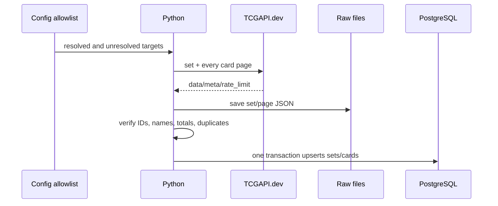
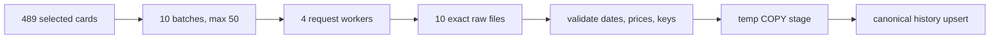
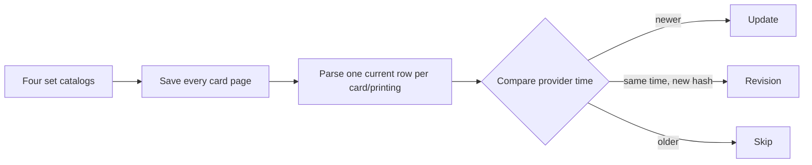
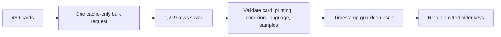
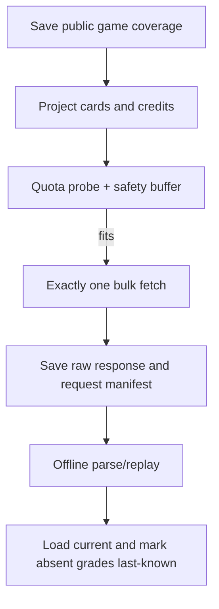
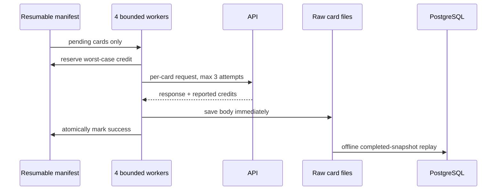

# Chapter 7 — Building the ETL Pipelines

Every workflow follows the same safety idea: define scope, preserve evidence,
validate completely, load transactionally, verify, then test repetition.

## Pipeline A — Card catalogs

**Objective:** normalize provider sets and cards for resolved targets.
**Endpoint:** `GET /sets/{id}` and paginated `GET /sets/{id}/cards?type=Cards`.
**Code:** `catalog_ingest.py::{load_targets,fetch_catalogs,load_catalogs}` and
`scripts/sync_target_catalogs.py`. **Tables:** `sets`, `cards`.

Four sets resolved and produced 489 cards: Pitch Black English, Mega Brave and
Mega Symphonia Japanese, and OP-17 English. Gem Pack Vol. 6 Simplified Chinese
and Japanese OP-17 remain `missing_tcgapi_coverage`; they are skipped without
substitution. Replaying updates the same provider identities rather than adding
duplicates. Verification: `sql/verify_catalog_load.sql`.

**Lesson:** language must come from verified provider catalog context because
set objects did not expose it. Successful searches with zero results are missing
coverage, not request failures.

## Pipeline B — Historical prices

**Objective:** load every available daily observation. **Endpoint:**
`GET /bulk/history`, `range=all`, at most 50 IDs. **Code:**
`history_ingest.py` and `sync_price_history.py`. **Table:** `price_history`.

The result was 117,828 rows covering 488 cards. Card `2185531` was confirmed by
an individual HTTP 200 response with empty `data`, so the manifest records
provider-omitted/no-history. The source/currency mapping is explicitly
`tcgapi.dev`/`USD` from verified endpoint metadata; the response itself has no
currency field.

Hashes distinguish revisions from repeats. New dates insert, changed content on
the same canonical date updates, unchanged rows remain untouched, and previously
stored dates missing from a later response are retained. Second run: 0 inserted,
0 revised, 117,828 unchanged. Verification:
`sql/verify_price_history_load.sql`.

## Pipeline C — Current market snapshots

**Objective:** keep the latest ungraded snapshot, not another historical series.
**Endpoint:** the existing set-card pages already expose current fields.
**Code:** `current_price_ingest.py` and `sync_current_prices.py`. **Table:**
`current_prices`.

All 489 cards loaded. One market price was `NULL`; none were zero; one row had a
stale-market indicator. `market_price_as_of`, provider time, and ingestion time
remain distinct. An altered older test row was skipped, and a second complete
run was unchanged. Verification: `sql/verify_current_price_load.sql` and
rollback tests in `test_current_price_constraints.sql`.

## Pipeline D — Condition-level pricing

**Objective:** load cached condition/listing-language prices without consuming
per-card warming allowances. **Endpoint:** `GET /bulk/conditions`, maximum 500
IDs. **Code:** `condition_price_ingest.py`; **table:** `condition_prices`.

The response covered all 489 cards, two listing languages, four printings, and
six conditions including `Unopened`. There were 345 `NULL` medians, all with
fewer than three samples. `sample_count` is sample depth, not total listings.
`warm_missing_cards=false` is configuration policy and is also written to the
manifest. Second run: all 1,219 unchanged. Verification:
`verify_condition_price_load.sql`.

## Pipeline E — Graded summaries

**Objective:** ingest provider-reported aggregate eBay grading summaries once
within a known credit budget. **Endpoint:** public coverage plus
`GET /bulk/prices?include=ebay`. **Code:** `graded_price_ingest.py` and the
mutually exclusive CLI modes in `sync_graded_prices.py`.

Coverage metrics must remain separate: 489 requested, 481 with any eBay data,
169 with graded summaries. Projection and actual cost were both 482 credits;
9,988 were available after the probe. The raw run is
`20261118T030326747840Z`.

The loader produced 1,264 raw-grade rows. It preserves `graded_days`, nullable
30-day median, zero window sales, and historical last sale independently. A
second offline replay inserted zero and used no API call. Verification:
`verify_graded_price_load.sql`.

## Pipeline F — Individual reported sales

**Objective:** preserve per-card provider observations without inventing event
identity. **Endpoint:** `GET /cards/{id}/prices?include=ebay_sales` for the frozen
481-card eligibility snapshot. **Code:** `reported_sale_ingest.py` and
`sync_reported_sales.py`. **Table:** `reported_sale_observations`.

The run `20261118T035224841879Z` completed 481/481 cards, used 962 reported card
credits, and produced 12,568 observations. It recorded 188 empty arrays, zero
missing arrays, and zero terminal API failures. Currency is `NULL` for every row.

Resume skips saved successes. Atomic manifest replacement retries temporary
OneDrive locks. The parser requires a completed run and the same eligibility
hash. Loading compares every existing replay key/hash; conflicts raise
`DataIntegrityError`. First replay inserted 12,568; second inserted zero.
Verification: `verify_reported_sale_load.sql`.

## Practice exercises

1. Choose one pipeline and write a failure table with four columns: failure
   point, evidence preserved, retry/replay behavior, and database impact.
2. Draw the canonical key for each of the six facts. Which keys describe latest
   state, daily history, aggregate grade state, or immutable snapshot position?
3. A history manifest says 489 requested, 488 with history, one provider
   omission, and zero failures. Is the run complete? What must reporting avoid
   claiming?
4. A sale extraction manifest says 470 successes and 11 pending. Explain why
   offline replay is still forbidden even though most raw files exist.

Solutions are in [Exercise answer key](16_EXERCISE_ANSWER_KEY.md#chapter-7--etl-pipelines).

