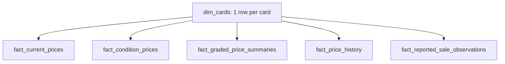

# Chapter 10 — Reporting and Power BI

## Reporting schema

`sql/010_create_reporting_views.sql` creates one dimension and five facts:

| View | Grain | Verified rows |
| --- | --- | ---: |
| `reporting.dim_cards` | one card joined to its set | 489 |
| `fact_current_prices` | latest card/source/currency/printing | 489 |
| `fact_condition_prices` | latest card/source/currency/printing/condition/language | 1,219 |
| `fact_graded_price_summaries` | card/source/currency/printing/raw grade | 1,264 |
| `fact_price_history` | card/source/printing/currency/day | 117,828 |
| `fact_reported_sale_observations` | pinned snapshot/card/printing/row | 12,568 |

Views do not aggregate operational rows. They expose provenance, currencies,
printings, provider dates, and quality/status fields. The reported-sales view is
pinned to `tcgapi.dev:ebay_sales:20261118T035224841879Z` so repeated snapshots
cannot be accidentally summed.

## Star schema

Power BI uses five active one-to-many, single-direction relationships on
`card_id`, flowing from Cards to each fact. There are no fact-to-fact
relationships. This prevents ambiguous filter paths.

## Import mode and refresh

Import mode copies the view results into the PBIX model. A manual Power BI
refresh re-runs the PostgreSQL view queries; it does not call TCGAPI.dev. The
completed model refreshed successfully and is saved in the project root.

Python ETL scheduling and Power BI refresh scheduling are separate:

1. ETL obtains and validates new provider data and commits PostgreSQL.
2. Power BI refresh imports the committed reporting-view state.

Running only step 2 cannot create fresh provider data. Neither production ETL
scheduling nor Power BI Service/gateway scheduling is implemented in Phase 1.

## Least-privilege access

`scripts/configure_power_bi_role.py` creates `graildtcg_powerbi` with no
superuser, database creation, role creation, replication, or row-level-security
bypass privileges. It grants only connection, reporting-schema usage, and SELECT
on the six views. `verify_reporting_login` counts every view and proves direct
`public.cards` access fails. Credentials live in ignored `.env.powerbi`.

## Why prices must not default to SUM

A market price is a value observed under a particular card, date, printing,
currency, source, and possibly condition/grade. Adding prices across cards or
dates usually has no business meaning. All 14 raw price columns were configured
as **Don't summarize**. Future DAX measures should explicitly choose `AVERAGE`,
`MEDIAN`, latest-row logic, or another justified calculation with currency and
grain filters.

## Latest versus last-known grades

The graded view derives `reporting_status` from
`is_reported_in_latest_snapshot`. A retained grade may still have historical
last-sale fields, but it must not be presented as a current 30-day valuation.
At Task 10 verification all 1,264 rows were current; the model supports future
last-known rows.

## Exercise

In a copy of the PBIX, add a card-name slicer and a table from each fact. Confirm
one card filters all five facts. Then deliberately create a fact-to-fact
relationship and observe why Power BI warns about ambiguity; remove it afterward.

Expected outcome: [exercise answer key](16_EXERCISE_ANSWER_KEY.md#chapter-10--power-bi-reporting).

