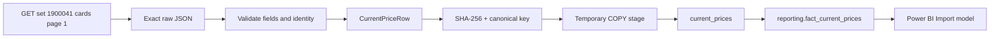

# Chapter 15 — End-to-End Worked Example

This chapter follows one implemented GraildTCG current-price record from local
provider evidence to Power BI. No value is invented and no live request is
made. The example is Bulbasaur from Japanese Mega Brave:

| Identity | Value |
| --- | --- |
| Provider card ID | `985728` |
| Internal card ID | `182` |
| Card | `Bulbasaur - 001/063` |
| Provider set ID | `1900041` |
| Set | `m1L: Mega Brave` |
| Printing | `Normal` |
| Source/currency | `tcgapi.dev` / `USD` |

## The whole path



## 1. Provider JSON response

The relevant object in the saved response is:

```json
{
  "id": 985728,
  "name": "Bulbasaur - 001/063",
  "number": "001/063",
  "rarity": "Common",
  "tcgplayer_id": 647110,
  "product_type": "Cards",
  "total_listings": 135,
  "printing": "Normal",
  "market_price": 0.13,
  "market_price_as_of": "2026-11-17",
  "low_price": null,
  "median_price": 0.2,
  "lowest_with_shipping": null,
  "price_updated_at": "2026-11-17T01:26:24.933Z",
  "no_market_price_since": null,
  "image_url": "https://product-images.tcgplayer.com/fit-in/400x400/647110.jpg"
}
```

The full immutable source is
`data/raw/tcgapi_current/20261117T132115619422Z/1900041/cards_page_001.json`.
This object is row 2 of the response `data` array.

Some source fields, such as name, number, rarity, and image URL, belong to the
card catalog dimension. The current-price pipeline uses the price, printing,
listing, and provider-time fields while verifying that the provider card ID is
already present in the selected catalog.

## 2. Python request function

`src/gmad/current_price_ingest.py::fetch_current_prices` calls:

```python
payload, raw_text = client.get_json_with_raw(
    "sets/1900041/cards",
    {"page": 1, "per_page": 100, "type": "Cards"},
)
```

`TcgApiClient.get_json_with_raw` uses the authenticated session, timeout, and
HTTP status check. It returns:

- `raw_text`: exact provider response text for evidence;
- `payload`: the same response parsed with `Decimal` for JSON floats.

If HTTP status is unsuccessful, JSON is invalid, or the top level is not an
object, the exception prevents this page from reaching the loader.

## 3. Raw file and provenance

Before row transformation, the function writes `raw_text` to the timestamped
run directory. The relative path becomes `source_file` on every row derived
from this page. `enumerate(data, start=1)` supplies
`source_row_number=2` for Bulbasaur.

Together, path and row number answer: “Where in the preserved response did this
database value come from?” They are provenance, not the canonical business key.

The first current-price manifest reports:

```json
{
  "run_id": "20261117T132115619422Z",
  "cards_requested": 489,
  "canonical_rows_received": 489,
  "inserted_rows": 489,
  "database_rows_after_load": 489
}
```

## 4. Validation and transformation

The response object passes these implemented checks:

| Check | Source value | Normalized result |
| --- | --- | --- |
| configured set membership | ID `985728` is in set 1900041 catalog | internal `card_id=182` |
| unique response identity | first occurrence of ID 985728 | accepted |
| product type | `Cards` | accepted |
| printing | nonblank `Normal` | `"Normal"` |
| market price | nonnegative JSON decimal `0.13` | `Decimal("0.13")` |
| low price | JSON `null` | `None` |
| median price | `0.2` | `Decimal("0.2")` |
| listings | integer `135` | `135` |
| market date | ISO `2026-11-17` | `date(2026, 11, 17)` |
| provider time | timezone-aware ISO timestamp | UTC-aware `datetime` |
| no-market marker | JSON `null` | `None` |

`source_name` and `currency_code` do not appear in this row. They come from the
verified ingestion config as `tcgapi.dev` and `USD`. The pipeline does not infer
currency from a URL or number format.

## 5. Normalized dataclass

The logical `CurrentPriceRow` is:

```python
CurrentPriceRow(
    card_id=182,
    tcgapi_card_id=985728,
    printing="Normal",
    market_price=Decimal("0.13"),
    low_price=None,
    median_price=Decimal("0.2"),
    lowest_with_shipping=None,
    total_listings=135,
    market_price_as_of=date(2026, 11, 17),
    provider_observed_at=datetime.fromisoformat(
        "2026-11-17T01:26:24.933+00:00"
    ),
    no_market_price_since=None,
    source_name="tcgapi.dev",
    currency_code="USD",
    source_file=(
        "data/raw/tcgapi_current/20261117T132115619422Z/"
        "1900041/cards_page_001.json"
    ),
    source_row_number=2,
    source_record_hash=(
        "d866e63a84122d9e0f63d34decc12255"
        "d19638bbca2ff5cc71fc98ec646815c2"
    ),
)
```

The canonical key is:

```text
(182, "tcgapi.dev", "USD", "Normal")
```

The hash includes the provider ID, price fields, printing, source/currency,
listing count, market date, provider timestamp, and staleness marker after
stable normalization. It excludes `loaded_at`, because ingestion time changes
on legitimate loads and is not provider content.

## 6. PostgreSQL staging

`load_current_prices` first compares the key against stored provider times and
hashes. On the initial run no key exists, so the Python diagnostic count is
`inserted_rows += 1`.

The loader creates `incoming_current_prices ON COMMIT DROP` from the canonical
column definitions and streams the dataclass using Psycopg `COPY`. At this
moment the record is typed stage data but is not yet a committed canonical row.

If any staged value cannot fit the PostgreSQL type, the transaction fails. The
raw file remains available for investigation; `current_prices` remains
unchanged.

## 7. Canonical insert or guarded update

The set-based `INSERT ... SELECT` finds no conflict on the initial run and
creates the row. On a replay, the unique constraint matches the four-part key.

- Same provider time and same hash: no update.
- Same time and changed hash: accepted provider revision.
- Newer provider time: accepted latest snapshot.
- Older provider time: rejected by the upsert `WHERE` guard.

The stored row is:

| Column | Stored value |
| --- | --- |
| `card_id` | 182 |
| `printing` | Normal |
| `market_price` | `0.1300000000000000` |
| `low_price` | `NULL` |
| `median_price` | `0.2000000000000000` |
| `lowest_with_shipping` | `NULL` |
| `total_listings` | 135 |
| `market_price_as_of` | 2026-11-17 |
| `provider_observed_at` | 2026-11-17 01:26:24.933+00 |
| `source_name` / `currency_code` | tcgapi.dev / USD |
| `source_file` / `source_row_number` | saved page / 2 |
| `source_record_hash` | `d866...15c2` |

PostgreSQL may display the `TIMESTAMPTZ` in the session timezone—for example,
12:26 in Australia/Sydney. That is the same instant, not a changed provider
timestamp.

## 8. SQL verification

This query proves identity, value, time, and provenance together:

```sql
SELECT
    c.card_id,
    c.tcgapi_card_id,
    c.card_name,
    c.card_number,
    s.set_name,
    cp.printing,
    cp.market_price,
    cp.median_price,
    cp.currency_code,
    cp.provider_observed_at,
    cp.source_file,
    cp.source_row_number,
    cp.source_record_hash
FROM cards AS c
JOIN sets AS s USING (set_id)
JOIN current_prices AS cp USING (card_id)
WHERE c.tcgapi_card_id = 985728;
```

Expected: exactly one row with `card_id=182`, price 0.13, median 0.2, USD,
Normal, source row 2, and the documented hash. A second complete saved response
produced 489 unchanged current rows, confirming exact replay did not duplicate
or rewrite this row.

## 9. Reporting view

`reporting.dim_cards` supplies the card/set attributes, while
`reporting.fact_current_prices` exposes the canonical current row without
aggregation. The relationship is `dim_cards.card_id` one-to-many to
`fact_current_prices.card_id`.

```sql
SELECT d.card_name, d.set_name,
       f.printing, f.market_price, f.currency_code,
       f.provider_observed_at, f.source_file,
       f.source_row_number, f.source_record_hash
FROM reporting.dim_cards AS d
JOIN reporting.fact_current_prices AS f USING (card_id)
WHERE d.tcgapi_card_id = 985728;
```

The view does not round, infer, or sum the price. Source identity, printing,
currency, provider timestamp, raw path, row number, and hash remain visible.

## 10. Power BI consumption

Power BI imports both views. The model relationship allows a Bulbasaur card or
Mega Brave set selection in `dim_cards` to filter this fact row. The raw price
column is configured as **Don't summarize**, preventing an implicit SUM.

A basic table visual can use:

- `dim_cards[card_name]`
- `dim_cards[set_name]`
- `fact_current_prices[printing]`
- `fact_current_prices[market_price]`
- `fact_current_prices[currency_code]`
- `fact_current_prices[provider_observed_at]`

The display should show Bulbasaur, Mega Brave, Normal, 0.13, USD, and the
provider time. A Power BI refresh only re-reads the reporting views; it does not
call TCGAPI.dev or create a newer provider snapshot.

## What remained unchanged across the path

| Concern | Preservation mechanism |
| --- | --- |
| provider identity | `tcgapi_card_id=985728` maps to internal `card_id=182` |
| printing | `Normal` is part of the canonical key |
| currency | explicit config value `USD`; never inferred |
| provider time | parsed timezone-aware, stored as `TIMESTAMPTZ` |
| ingestion time | separate `loaded_at`; never used as provider time |
| provenance | immutable raw path plus source row 2 |
| content identity | normalized SHA-256 `d866...15c2` |
| reporting grain | view exposes the same canonical row without aggregation |

## Practice exercises

1. If the next saved page reports price 0.14 at a newer provider time, list the
   fields that change and the fields that remain stable.
2. If price 0.14 arrives with the same provider time, which mechanism labels it
   a revision rather than an unchanged replay?
3. If Power BI shows 0.26 after adding the same price field twice, where should
   you investigate first: source JSON, canonical SQL, relationship model, or
   visual aggregation?

Solutions are in [Exercise answer key](16_EXERCISE_ANSWER_KEY.md#chapter-15--end-to-end-worked-example).
